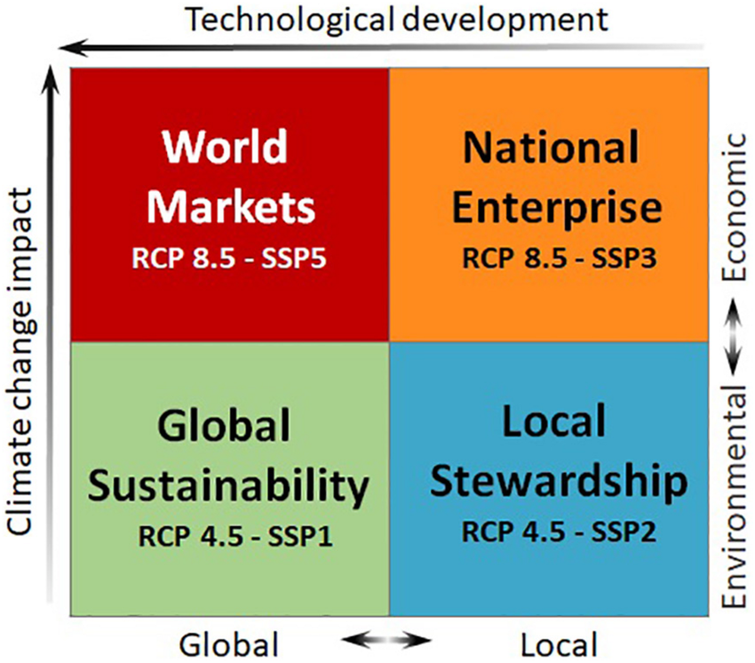
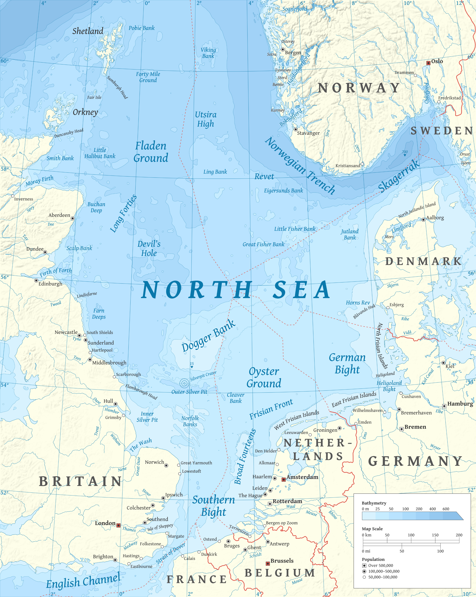
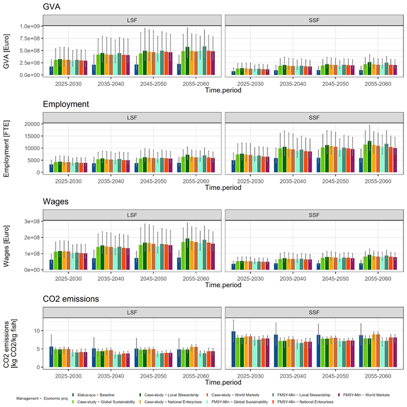
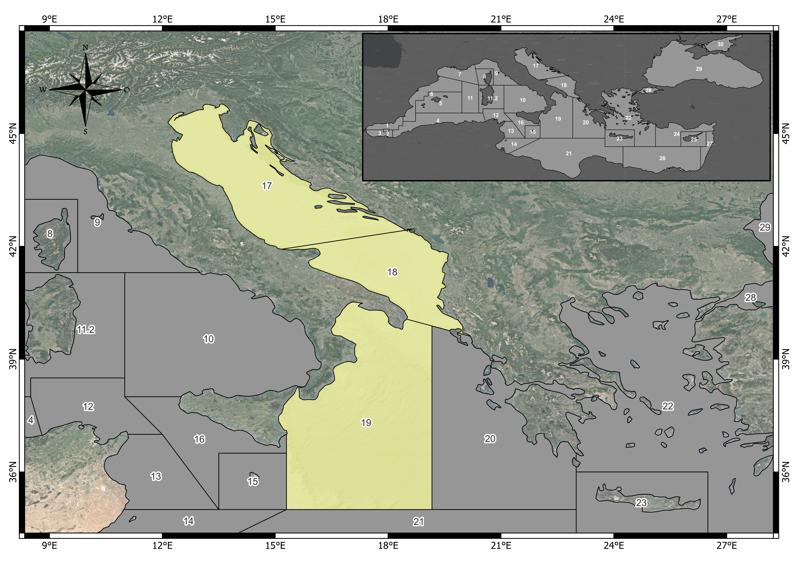
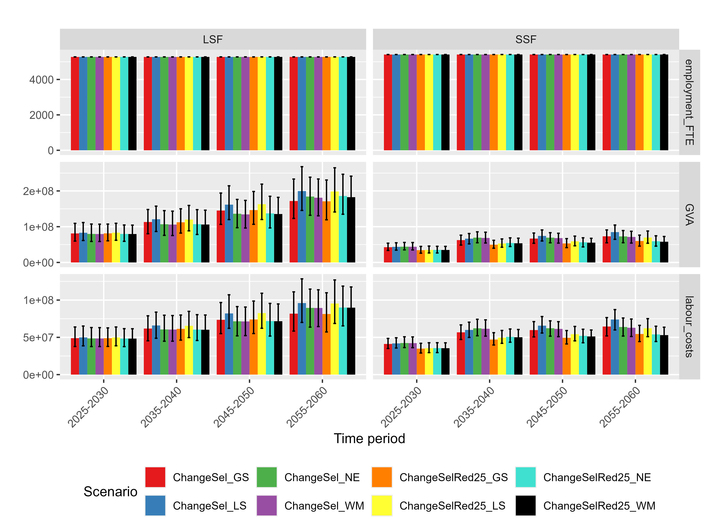

```{r, echo=FALSE}
cat(sprintf("Compiled on %s\n\n", format(Sys.time(), '%d/%m/%Y, %H:%M')))
```

<!-- Logo in the title -->

```{=html}
<style>
/* Make the title line a flex row with the logo on the left */
.title-with-logo {
  display: flex;
  align-items: center;
  gap: 14px;              /* spacing between logo and text */
  margin-top: 0.5rem;
  margin-bottom: 1rem;
}
.title-with-logo img {
  width: 120px;           /* adjust logo size as needed */
  height: auto;
}
</style>
```

```{=html}
<script>
// Wrap the H1.title with a container and prepend the logo to its left
document.addEventListener("DOMContentLoaded", function(){
  // find the auto-generated title element
  var h1 = document.querySelector("h1.title");
  if(!h1) return;

  // create wrapper
  var wrap = document.createElement("div");
  wrap.className = "title-with-logo";

  // create logo
  var img = document.createElement("img");
  img.src = "seawise_logo_fullcolour.png";   // relative path from Rmd root
  img.alt = "SEAwise logo";

  // insert: wrap replaces h1, then put logo + h1 inside wrap
  h1.parentNode.insertBefore(wrap, h1);
  wrap.appendChild(img);
  wrap.appendChild(h1);
});
</script>
```

<!-- Links -->

::: {#header-links}
<a href="https://seawiseproject.org/" target="_blank">

SEAwise Website </a>
<a href=https://github.com/ices-tools-dev/SEAwise" target="_blank">

SEAwise Github </a>
:::

<!-- start of the script -->

## Introduction{.tabset} 

This tutorial is based on the work carried out in SEAwise – Work Package 2: Social and economic effects of and on fishing.

Within SEAwise (seawiseproject.org), the socio-economic impacts of a set of management measures were investigated and quantified using bio-economic modelling. The project developed methodologies to strengthen the economic sub-models integrated into bio-economic models for Ecosystem-Based Fisheries Management (EBFM), improving the configuration of the economic component through more realistic fleet performance projections ([Enhancing Fish price in FLBEIA](https://fundacion-azti.github.io/FLBEIA_SEAWISE_WP2/) and  [Enhanced fish price & fuel costs submodels](https://coispa.github.io/Fish-price-and-variable-costs/Enhanced_fishprice_fuelcosts_submodels.html).

In SEAwise Deliverables 2.3 [SEAwise report on carbon footprint, economic and social impacts](https://data.dtu.dk/articles/online_resource/SEAwise_report_on_Carbon_footprint_economic_and_social_impacts_of_revised_management_strategies/28079393) and 2.4 [SEAwise report on carbon footprint and impacts in a changing climate](https://data.dtu.dk/articles/online_resource/SEAwise_Report_on_Carbon_footprint_economic_and_social_impacts_of_revised_management_strategies_in_a_changing_climate_based_on_information_from_full_MSEs/29194667)), a set of integrated socio-economic and management scenarios were developed to assess the impacts of fisheries management strategies under changing environmental and market conditions. 


## Socio-economic scenarios

Four socio-economic scenarios, adapted from the CERES project (https://ceresproject.eu/), were explored:

* **Global Sustainability (GS) (RCP4.5, SSP1):** global sustainability is prioritized, aiming to limit climate change to the lower RCP4.5 target while striving to promote welfare by balancing economic, social, and environmental considerations, supported by strong trans-boundary cooperation. Key factors such as a smaller global population, improved fish stock management, cheaper sources of fish meal and oil for aquaculture, and increased competition between farmed and wild fish contribute to a more moderate rise in fish prices compared to other scenarios. 
 	
* **National Enterprise (NE) (RCP8.5, SSP3):** governments prioritize national interests, focusing on maximizing welfare and employment within the fishing industry, but with reduced trans-national cooperation. Fish prices remain high to support national well-being and due to an increase in per capita consumption. Global warming is expected to follow the RCP8.5 trajectory, driven by limited technological innovation and a heavy reliance on fossil fuels, resulting in a significant rise in fuel prices.
 	
* **Local Stewardship (LS) (RCP4.5, SSP2):** this scenario envisions a path where sustainability is pursued through small-scale regional efforts, emphasizing equity, social inclusion, and democratic values.  Global warming is expected to follow the milder RCP4.5 warming, with relatively high rate of fish price increase but lower fuel price increase than the 'National Enterprise' scenario. 

* **World Markets (WM) (RCP8.5, SSP5):** this scenario is defined by strong demand for affordable seafood (with a moderate rise in fish prices), increased technological innovation driven by global competition, lower taxes, and a robust private sector. While global warming follows the RCP8.5 pathway, the increase in fuel prices is slower than in the "National Enterprise" scenario, due to greater technological advancements.

These scenarios combined different pathways of climate change (RCP4.5 and RCP8.5) with varying trajectories for fish and fuel prices, reflecting political, economic, social, and technological factors influencing the fisheries sector.


<p align="center">
  
</p>


```{r, echo=FALSE, results='asis', message=FALSE}

library(knitr)
library(kableExtra)

cat('<div style="text-align:center; font-weight:300; margin-bottom:0.5rem;">
Figure 1 - Socio-political scenarios elaborated for European fisheries in CERES project [Peck et al., (2020)](https://doi.org/10.25592/uhhfdm.803)
</div>')


```

Each socio-economic scenario corresponds to a combination of fish and fuel price increase. Annual rates of fuel and fish price increase corresponding to the four scenarios summarized in Figure 1 (CERES scenarios) are reported in Table 1.

```{r, echo=FALSE}

df <- data.frame(
  Scenario= c("GS_RCP4.5_SSP1","LS_RCP4.5_SSP2","NE_RCP8.5_SSP3","WM_RCP8.5_SSP5"),
  FishPriceIncreaseRate= c("1.33","1.64","1.67","1.57"),
  FuelPriceIncreaseRate=c("2.59","2.61","2.89","2.59")
)


```

```{r, echo=FALSE, results='asis', message=FALSE}

cat('<div style="text-align:center; font-weight:300; margin-bottom:0.5rem;">
Table 1- Fish and Fuel price annual-increase rates [%] for each of the four socio-political scenarios: World Market (WM), National Enterprise (NE), Local Stewardship (LS), Global Sustainability (GS).SSP stands for socio-political scenarios (Figure 1) and RCP stands for Representative concentration pathways (RCP4.5 moderate climate impact; RCP8.5 extreme climate impact)
</div>')

kable(df, align = c("l","l")) %>%
  kable_styling(full_width = FALSE, position = "center",
                bootstrap_options = c("striped", "bordered", "bordered")) %>%
  collapse_rows(columns = 1, valign = "top")


```

This document presents three examples of how the socio-economic scenarios can be implemented in bio-economic models (FLBEIA and BEMTOOL): 

 - dummy dataset;
 - North Sea;
 - Adriatic and western Ionian Sea.
 
## Implementing socio-economic scenarios in FLBEIA - dummy  data set

This example uses the FLBEIA dummy dataset and show how the four CERES scenarios can be implemented using R, integrating the increase in fish and fuel price in the projections.

```{r FLBEIA, echo=TRUE}
#install.packages(c("ggplot2", "Matrix", "nloptr", "mvtnorm", "triangle", "XLConnect"))
#remotes::install_github("flr/FLCore")
#remotes::install_github("flr/FLFleet")
#remotes::install_github("flr/FLash")
#remotes::install_github("flr/FLBEIA")
library(FLCore) 
library(FLBEIA) 

# load the FLBEIA input lists (biols, fleets, BD, SRs, etc.)
data(one)  # this is the FLBEIA dummy data set 

first.yr          <- 1990
proj.yr           <- 2010 
last.yr           <- 2025  
yrs <- c(first.yr=first.yr, proj.yr=proj.yr, last.yr=last.yr)

i1  <- yrs['proj.yr'] - yrs['first.yr'] + 1  # position of first projection yr in objects
i2  <- yrs['last.yr'] - yrs['first.yr'] + 1  # position of last yr in objects

 
```

The first step is to define the tables with annual change rates in fish and fuel prices, following the scenarios described above. 

```{r FLBEIA2, echo=TRUE}

# ----- annual increase rate of Fish prices
fish_price <- matrix(NA, nrow=1, ncol=4)
fish_price <- c(1.57, 1.67, 1.33, 1.64)         # annual increase rates per scenario
names(fish_price) <- c('WM', 'NE', 'GS', 'LS')
fish_price        <- fish_price/100             # divide by 100 as the are % rates
fish_price

# ----- annual increase rate of fuel prices
fuel_price <- matrix(NA, nrow=3, ncol=4)
fuel_price <- c(2.59, 2.80, 2.59, 2.61)         # annual increase rates per scenario
names(fuel_price) <- c('WM', 'NE', 'GS', 'LS')         
fuel_price           <- fuel_price/100          # divide by 100 as the are % rates
fuel_price

```

Then, the fraction of Variable costs corresponding to the fuel costs by fleet-metier combination have to be defined. This is case study specific.


```{r FLBEIA3, echo=TRUE}

fuelcost_fr        <- matrix(NA, nrow=1, ncol=1)
fuelcost_fr        <- c(0.5)       # fraction of variable costs that is due to fuel costs per metier
names(fuelcost_fr) <- c('met1')    # name of metier      
fuelcost_fr

```

In this example there is only 1 fleet and one metier. The script can be generalised to cover all metiers, as follows: 

```{r FLBEIA4, echo=TRUE}
fuelcost_fr_bkp<-fuelcost_fr

fuelcost_fr        <- matrix(NA, nrow=1, ncol=3) # ncol equals to the number of metiers
fuelcost_fr        <- c(0.5, 0.3, 0.4)       # fraction of variable costs that is due to fuel costs per metier
names(fuelcost_fr) <- c('met1', 'met2', 'met3')    # name of metier      
fuelcost_fr

```

The next step is the modificaton of fish prices in the fleets object before calling FLBEIA. In the following example, fish prices are changed according to 'WM' scenario.

```{r FLBEIA5, echo=TRUE}

# FISH PRICE

x          <- seq(1, i2 - i1 + 1, 1)   # sequence of years to modify
rate       <- fish_price['WM']         # select scenario
price_mult <- (1 + rate)^x             # these are the fish price multipliers

# for stock1
for (i in 1 : 12){  # repeat for all age classes
  oneFl[["fl1"]]@metiers[["met1"]]@catches[["stk1"]]@price[i, i1:i2, , , ] <- oneFl[["fl1"]]@metiers[["met1"]]@catches[["stk1"]]@price[i, i1:i2, , , ]*price_mult 
  # ... add all fleets and metier for the given stock
}

# for stock 2
#...

# for stock 3
#...

```

Energy or fuel costs form a given fraction of variable costs for each fleet-metier combination. Fuel costs increase with fuel prices. The annual multiplier for fuel costs is $\mathtt{mult} = 1 + \mathtt{fuel\_price}$, where `fuel_price` is the annual rate of change. The annual change in the variable-cost multiplier due to fuel is $(\mathtt{mult} - 1)\,\mathtt{fuelcost\_fr}$, where `fuelcost_fr` is the fuel share of variable costs.

```{r FLBEIA6, echo=TRUE}
fuelcost_fr<-fuelcost_fr_bkp

fuelcost_mult     <- (1 + fuel_price['WM']) 
vcost_mult        <- (1 + (fuelcost_mult - 1) * fuelcost_fr)
vcost_m           <- matrix(NA, nrow=(last.yr - proj.yr + 1), ncol=length(vcost_mult))
vcost_m[,1]       <- vcost_mult[1]^x

# In this example there is 1 metier. Fill in vcost columns for each of your metiers 
#  vcost_m[,2]       <- vcost_mult[2]^x
#  vcost_m[,3]       <- vcost_mult[3]^x
# ...  

colnames(vcost_m) <- c('met1')  # name vcost with the names of metiers (as in the FLBEIA objects)
vcost_m

# apply it to all fleets and metiers
oneFl[["fl1"]]@metiers[["met1"]]@vcost[, i1:i2, , , ] <- oneFl[["fl1"]]@metiers[["met1"]]@vcost[, i1:i2, , , ]*vcost_m[,'met1'] 
# oneFl[["fl1"]]@metiers[["met2"]]@vcost[, i1:i2, , , ] <- oneFl[["fl1"]]@metiers[["met2"]]@vcost[, i1:i2, , , ]*vcost_m[,'met2'] 
# ...
```

Finally, the FLBEIA model can be called for the WM scenario: 


```{r FLBEIA7, results = 'hide'}

WM <- FLBEIA(biols = oneBio,
              SRs = oneSR,      
              BDs = NULL,        
              fleets = oneFl,   
              covars = oneCv,   
              indices = NULL,
              advice = oneAdv,
              main.ctrl = oneMainC,
              biols.ctrl = oneBioC,
              fleets.ctrl = oneFlC,
              covars.ctrl = oneCvC,
              obs.ctrl = oneObsC,
              assess.ctrl = oneAssC, 
              advice.ctrl = oneAdvC) 
```

Examples of graphical output that can be extracted by the WM object follow: 

```{r FLBEIA8, echo=TRUE} 
library(dplyr)
stk <- names(WM$biols)[1]

ssb_df <- as.data.frame(ssb(WM$biols[[stk]])) %>%   # quant="ssb" already implicit
  rename(SSB = data) %>%
  group_by(year) %>%
  summarise(med = median(SSB, na.rm=TRUE),
            lo  = quantile(SSB, 0.10, na.rm=TRUE),
            hi  = quantile(SSB, 0.90, na.rm=TRUE))

ggplot(ssb_df, aes(x=as.numeric(as.character(year)), y=med)) +
  geom_ribbon(aes(ymin=lo, ymax=hi), alpha=0.2) +
  geom_line(size=1) +
  labs(x="Year", y="SSB", title=paste("SSB -", stk), subtitle="median and 80% CI") +
  theme_minimal()

```

Below, the revenues are estimated from the price per kg and the landing in weight: 

```{r FLBEIA9, echo=TRUE} 
library(FLCore)
library(dplyr)
library(purrr)
library(tidyr)
library(ggplot2)

calc_revenue_cost_profit <- function(WM){
  fleets <- WM$fleets
  all_fleets <- names(fleets)

  map_dfr(all_fleets, function(fl){
    fobj <- fleets[[fl]]

    # ---- Revenues: sum on all metier and catches: landings.wt * price ----
    rev_df <- map_dfr(names(fobj@metiers), function(mt){
      met <- fobj@metiers[[mt]]
      map_dfr(names(met@catches), function(st){
        ct <- met@catches[[st]]
        if(!("landings.wt" %in% slotNames(ct)) || !("price" %in% slotNames(ct))) return(NULL)

        wt_df <- as.data.frame(ct@landings.wt) %>% rename(wt = data)
        pr_df <- as.data.frame(ct@price)       %>% rename(p  = data)

        inner_join(wt_df, pr_df, by=c("year","unit","season","area","iter")) %>%
          mutate(revenue = wt * p) %>%
          group_by(year, iter) %>%
          summarise(revenue = sum(revenue, na.rm=TRUE), .groups="drop")
      })
    }) %>%
      group_by(year, iter) %>%
      summarise(revenue = sum(revenue, na.rm=TRUE), .groups="drop")

    # ---- Costs (if exist): it search common slots on fleet and metiers ----
    cost_slots_fleet  <- intersect(c("vcost","fcost","crewsal","capital","crewshare"), slotNames(fobj))
    cost_df_fleet <- NULL
    if(length(cost_slots_fleet) > 0){
      cost_df_fleet <- map_dfr(cost_slots_fleet, function(slt){
        as.data.frame(slot(fobj, slt)) %>%
          rename(val = data) %>%
          group_by(year, iter) %>%
          summarise(val = sum(val, na.rm=TRUE), .groups="drop")
      }) %>% group_by(year, iter) %>% summarise(cost = sum(val, na.rm=TRUE), .groups="drop")
    }

    # costs by metier (if not present al fleet level)
    cost_df_met <- NULL
    if(is.null(cost_df_fleet)){
      cost_df_met <- map_dfr(names(fobj@metiers), function(mt){
        met <- fobj@metiers[[mt]]
        cslots <- intersect(c("vcost","fcost","crewsal","capital"), slotNames(met))
        if(length(cslots)==0) return(NULL)
        map_dfr(cslots, function(slt){
          as.data.frame(slot(met, slt)) %>%
            rename(val = data) %>%
            group_by(year, iter) %>%
            summarise(val = sum(val, na.rm=TRUE), .groups="drop")
        })
      })
      if(!is.null(cost_df_met)){
        cost_df_met <- cost_df_met %>% group_by(year, iter) %>%
          summarise(cost = sum(val, na.rm=TRUE), .groups="drop")
      }
    }

    cost_df <- if(!is.null(cost_df_fleet)) cost_df_fleet else cost_df_met

    out <- if(is.null(cost_df)){
      # if the costs are not present, return only the revenue and profit=NA
      rev_df %>% mutate(cost = NA_real_, profit = NA_real_, fleet = fl)
    } else {
      full_join(rev_df, cost_df, by=c("year","iter")) %>%
        mutate(revenue = replace_na(revenue, 0),
               cost    = replace_na(cost, 0),
               profit  = revenue - cost,
               fleet   = fl)
    }
    out
  })
}

eco <- calc_revenue_cost_profit(WM)

# summary by year and fleet
eco_summ <- eco %>%
  group_by(fleet, year) %>%
  summarise(revenue_med = median(revenue, na.rm=TRUE),
            revenue_lo  = quantile(revenue, 0.10, na.rm=TRUE),
            revenue_hi  = quantile(revenue, 0.90, na.rm=TRUE),
            profit_med  = if(all(is.na(profit))) NA_real_ else median(profit, na.rm=TRUE),
            profit_lo   = if(all(is.na(profit))) NA_real_ else quantile(profit, 0.10, na.rm=TRUE),
            profit_hi   = if(all(is.na(profit))) NA_real_ else quantile(profit, 0.90, na.rm=TRUE),
            .groups="drop")


```

Plots at different levels of detail (e.g. metier, fleet) follow: 

```{r FLBEIA10, echo=TRUE} 

p1 <- ggplot(eco_summ,
       aes(x = as.numeric(as.character(year)),
           y = revenue_med, color = fleet, fill = fleet)) +
  geom_ribbon(aes(ymin = revenue_lo, ymax = revenue_hi), alpha = 0.15, colour = NA) +
  geom_line(size = 1) +
  labs(x="Year", y="Revenues (ton x price)", title="Revenues by fleet (median and 80% CI)") +
  theme_minimal()


eco_summ_prof <- eco_summ %>% filter(!is.na(profit_med))

if(nrow(eco_summ_prof) > 0){
  p2 <- ggplot(eco_summ_prof,
         aes(x = as.numeric(as.character(year)),
             y = profit_med, color = fleet, fill = fleet)) +
    geom_ribbon(aes(ymin = profit_lo, ymax = profit_hi), alpha = 0.15, colour = NA) +
    geom_line(size = 1) +
    labs(x="Year", y="Profit", title="Profit by fleet  (median and 80% CI)") +
    theme_minimal()
} 


# Revenues by metier
rev_met <- purrr::map_dfr(names(WM$fleets), function(fl){
  fobj <- WM$fleets[[fl]]
  purrr::map_dfr(names(fobj@metiers), function(mt){
    met <- fobj@metiers[[mt]]
    purrr::map_dfr(names(met@catches), function(st){
      ct <- met@catches[[st]]
      if(!("landings.wt" %in% slotNames(ct)) || !("price" %in% slotNames(ct))) return(NULL)
      wt_df <- as.data.frame(ct@landings.wt) %>% rename(wt = data)
      pr_df <- as.data.frame(ct@price)       %>% rename(p  = data)
      inner_join(wt_df, pr_df, by=c("year","unit","season","area","iter")) %>%
        mutate(revenue = wt * p, fleet = fl, metier = mt, stock = st) %>%
        group_by(fleet, metier, year, iter) %>%
        summarise(revenue = sum(revenue, na.rm=TRUE), .groups="drop")
    })
  })
})

rev_met_s <- rev_met %>%
  group_by(fleet, metier, year) %>%
  summarise(med = median(revenue, na.rm=TRUE),
            lo  = quantile(revenue, 0.10, na.rm=TRUE),
            hi  = quantile(revenue, 0.90, na.rm=TRUE),
            .groups="drop")

p3<- ggplot(rev_met_s, aes(x=as.numeric(as.character(year)), y=med, color=metier)) +
  geom_ribbon(aes(ymin=lo, ymax=hi, fill=metier), alpha=0.15, colour=NA) +
  geom_line(size=1) +
  facet_wrap(~ fleet, scales="free_y") +
  labs(x="Year", y="Revenues", title="Revenues per metier (facet by fleet)") +
  theme_minimal()

```


```{r fig-eco-layout, fig.width=10, fig.height=8, fig.cap='Example plots.'}
pkgs <- c("ggplot2","patchwork","cowplot")
to_install <- setdiff(pkgs, rownames(installed.packages()))
if(length(to_install)) install.packages(to_install)
library(ggplot2); library(patchwork); library(cowplot)

p_comb <- (p1 + p2) / p3 +
  plot_layout(guides = "collect", axes = "collect") &
  theme(legend.position = "bottom")

# Etichette A, B, C
p_comb <- p_comb + plot_annotation(tag_levels = "A")

p_comb


```

## Implementing socio-economic scenarios in FLBEIA - North Sea

### Introduction

The mixed fisheries model of the North Sea is defined using the procedure of WGMIXFISH-Advice 2021 and 2022. The modelling framework is FLBEIA (Garcia et al., 2017), and includes 46 fleets (152 total métiers) and 20 stocks for the North Sea mixed fisheries. Stock dynamics are either age-based (COD-NS, HAD, PLE-EC, PLE-NS, POK, SOL-NS, SOL-EC, TUR, WHG-NS, WIT), or fixed (NEP6, NEP7, NEP8, NEP9, NEP5, NEP10, NEP32, NEP33, NEP34, NEPOTH-NS) and differ whether they are actively managed via a TAC advice or, in some cases, considered as bycatch stocks.
For this case study please refer to [Kuehn et al. (2023)](https://doi.org/10.1111/fme.12629), Deliverables 2.3 [SEAwise report on carbon footprint, economic and social impacts](https://data.dtu.dk/articles/online_resource/SEAwise_report_on_Carbon_footprint_economic_and_social_impacts_of_revised_management_strategies/28079393) and 2.4 [SEAwise report on carbon footprint and impacts in a changing climate](https://data.dtu.dk/articles/online_resource/SEAwise_Report_on_Carbon_footprint_economic_and_social_impacts_of_revised_management_strategies_in_a_changing_climate_based_on_information_from_full_MSEs/29194667)).

<p align="center">
  
</p>

### 1. Purpose

This chapter outlines how to:

1) build projected multipliers for costs and prices (script **01_prepare_projCosts.R**), and  
2) apply them to FLBEIA multi-run simulations (script **02_Add_Economic_data_to_FLBEIA_simulations.R**),  
to produce *EMSRR economic projections* for the North Sea — without embedding internal code.

The script used in this chapter of the tutorial are available on SEAwise github (task 2.2), stored in the zip-file [add_price_scenarios_to_FLBEIA.zip](https://github.com/ices-tools-dev/SEAwise_T2.2/blob/main/add_price_scenarios_to_FLBEIA.zip). It contains following two scripts:

1. Data preparation: **01_prepare_projCosts.R**;
2. Add economic data to simulations: **02_Add_Economic_data_to_FLBEIA_simulations.R**.

In the following we just want to go through the main-steps with you, highlighting how to add additional information originating from economic projections to FLBEIA output. The way we do it here, is simply post-processing of available FLBEIA simulations. 


### 2. Inputs & Required Files

- `output/fleets.Rdata` (base fleets object for FLBEIA).
- `growthRate.csv` (annual % growth by country; first column `country`, following columns = years).
- `priceRate.csv` (rows = scenarios `scen`; columns include `year`, `var` in {`fuel_price`,`fish_price`}, and `rate`).
- `output/frac_fcost.2060.Rdata` (fixed-cost fractions per fleet).
- `output/frac_vcost.2060.Rdata` (variable-cost fractions per fleet/metier).
- For script 0.2: directory `output/multi_econ/EMSRR/` containing multi-iteration files (`SR.ensembles*`) for the relevant climate scenarios.

### Step 1 — Build Economic Multipliers (01_prepare_projCosts.R)

This script prepares the economic multipliers for each fleet and metier separately.
What it does:

1) Loads out fleet-definition `fleets` (output/fleets.Rdata), sets yrMax = 2100, and set a reference year yrRef = 2018.
2) From growthRate.csv, computes cumulative inflation factors by country (flat extrapolation beyond last available year).
3) From priceRate.csv, compute cumulative factors for fuel_price and fish_price by scenario.
4) Merge the above and using frac_fcost.2060.Rdata and frac_vcost.2060.Rdata, derive:
    * relFcost (fixed-cost multiplier via inflation),
    * relVcost (variable-cost multiplier: non-fuel share via inflation + fuel share via fuel_price),
    * relPrice (fish price multiplier).
5) Normalize relative to 2018 (yrRelCost = 2018, yrRelPrice = 2018).

Output: output/relEcon.Rdata with columns: fleet, metier, scen, year, relVcost, relFcost, relPrice.


### Step 2 — Modify FLBEIA runs to incorporate economic projections  (02_Add_Economic_data_to_FLBEIA_simulations.R)

Now that we have a lookup table with our fleet/métier-specific rates for fixed costs, variable costs and fish prices, we add those scenario-specific rates to the FLBEIA output e.g. one iteration of a stochastic scenario projection. 

What it does:

1) Cleans environment, load FLR-packages and helper-functions.
2) Define the time horizon: first.yr = 2014, proj.yr = 2019, last.yr = 2060.
3) Load the output/relEcon.Rdata; harmonise scenario labels (e.g., RCP6.0 → RCP4.5).
4) Selects economic scenarios consistent with climate scenarios (RCP4.5, RCP8.5).
6) For each economic scenario and HCR (e.g., FmsyH):
7) Find the matching multi-iteration result files in output/multi_econ/EMSRR/ (those carrying SR.ensembles).
8) Loads the run object and extract the fleets-obj: res$fleets.
9) Apply the multipliers over projection years to the:
    * fcost (fixed costs, once per fleet),
    * vcost per metier (variable costs),
    * price for each stock caught by that metier in each catch object (via helper update.price).

Output: output/multi_econ/EMSRR/econ_projections/<run>_econ_projection_<scenario>.RData

### Results — graphics (from relEcon.Rdata)

Here we just plot the different growth rates in fixed and variable costs as well as fish prices for the respective scenarios:

```{r fig-eco-layout2, fig.width=10, fig.height=8, fig.cap='Example plots.',eval = F}

# Packages
# (Install once if needed: install.packages(c("tidyverse","scales")))
suppressPackageStartupMessages({
  library(dplyr)
  library(tidyr)
  library(ggplot2)
  library(stringr)
  library(scales)
})

# Load the multipliers prepared by 01_prepare_projCosts.r
load(file.path("output","relEcon.Rdata"))  # loads `relEcon`

stopifnot(exists("relEcon"))
relEcon <- relEcon %>%
  mutate(year = as.integer(year),
         scen = as.character(scen),
         fleet = as.character(fleet),
         metier = as.character(metier))

# --- (Optional) Focus on a subset of North Sea fleets/metiers ------------------
# If you want to specify exactly which fleets/metiers to show, list them here:
# pairs_keep <- tibble(fleet = c("UK_Trawl_24_40","NL_Beam_40plus"),
#                      metier = c("OTB_DEF","TBB_MIX"))
# Otherwise, we take the 6 most common pairs (edit n = ...)
pairs_keep <- relEcon %>%
  count(fleet, metier, sort = TRUE) %>%
  slice_head(n = 6) %>%
  select(fleet, metier)

relNS <- relEcon %>% inner_join(pairs_keep, by = c("fleet","metier"))

# Helper labels
metric_labs <- c(relFcost = "Fixed-cost multiplier",
                 relVcost = "Variable-cost multiplier",
                 relPrice = "Fish price multiplier")

last_year <- max(relNS$year, na.rm = TRUE)
ref_year  <- 2018L

# =========================
# Figure NS-1: Multipliers over time
# =========================
df_long <- relNS %>%
  pivot_longer(c(relFcost, relVcost, relPrice),
               names_to = "metric", values_to = "value")

p1 <- ggplot(df_long,
             aes(x = year, y = value,
                 color = scen,
                 group = interaction(fleet, metier, scen))) +
  geom_line(alpha = 0.8, linewidth = 0.6) +
  facet_wrap(~ metric, ncol = 1, scales = "free_y",
             labeller = as_labeller(metric_labs)) +
  labs(title = "North Sea — Cost & price multipliers over time (2018 = 1)",
       subtitle = "Selected fleets/metiers; color = scenario",
       x = NULL, y = "Multiplier", color = "Scenario") +
  scale_y_continuous(labels = number_format(accuracy = 0.01)) +
  theme_minimal(base_size = 11)

print(p1)


```

An example of outcome from Deliverable 2.4 is reported below: 


<p align="center">
  
</p>

## Implementing socio-economic scenarios in BEMTOOL - Adriatic and western Ionian Sea

This chapter summarises the main steps to implement the socio-economic scenarios in BEMTOOL model.

### Introduction

BEMTOOL is a bio-economic multi-fleet and multiple stocks simulation model ([Rossetto et al. (2015)](https://www.sciencedirect.com/science/article/abs/pii/S0308597X1400298X) and [Bitetto et al.(2025)](https://cdnsciencepub.com/doi/10.1139/cjfas-2024-0382)) and it  has been applied in SEAwise to model the demersal fisheries in Adriatic and wester Ionian Sea. BEMTOOL model includes 24 fleet segments, that which encompass both active and passive gears targeting demersal resources, and covers the dynamics of 10 key target stocks: European hake in GSAs 17-18, European hake in GSA 19, Red mullet in GSAs 17-18, Red mullet in GSA 19, Deep-water rose shrimp in GSAs 17-18-19, Common sole in GSA 17, Norway lobster in GSA 17, Norway lobster in GSA 18, giant red shrimp in GSAs 18-19 and blue and red shrimp in GSAs 18-19. More detailes can be found in Deliverables 2.3 [SEAwise report on carbon footprint, economic and social impacts](https://data.dtu.dk/articles/online_resource/SEAwise_report_on_Carbon_footprint_economic_and_social_impacts_of_revised_management_strategies/28079393) and 2.4 [SEAwise report on carbon footprint and impacts in a changing climate](https://data.dtu.dk/articles/online_resource/SEAwise_Report_on_Carbon_footprint_economic_and_social_impacts_of_revised_management_strategies_in_a_changing_climate_based_on_information_from_full_MSEs/29194667)).

<p align="center">
  
</p>

### Steps to run socio-economic scenarios

The steps to implement the socio-economic scenarios in BEMTOOL are basically 4:

1) to run the scenarios combining management strategy and RCP effect on the stocks (following the WP3 and WP6 tutorials on BEMTOOL). 
For examples you will have these folders: 1) SQ-RCP4.5, 2) Fmsy-RCP45, 3) SQ-RCP8.5, 4) Fmsy-RCP85.

2) create for each climate scenario a copy. From scenario 1) you will create a copy: one will be renamed as SQ-RCP4.5_GS and the other SQ-RCP4.5_LS. Duplicating scenario 2) you will have Fmsy-RCP45_GS and Fmsy-RCP45_LS. From scenarios 3) you will have SQ-RCP8.5_NE and SQ-RCP8.5_WM and the same for scenario 4): Fmsy-RCP85_NE and Fmsy-RCP85_WM.

From the 4 scenarios at point 2 you need to have 8 scenarios, duplicating each of the four, following the climate scenario associated to the relevant socio-economic scenario (as described in chapter 2).

3) Now we need to update in the 8 folders the indicators impacted by the socio-economic scenarios: 
- revenues and variables costs (according change in fuel and fish price in Table 1);
- labour costs

Here an example of update for one scenario:

```{r BEMTOOL, echo=TRUE, results='hide'}

# ChangeSel_RCP45_GS : fish price: 1.33	Fuel price: 2.59

fi_pr=1.33
fu_pr=2.59


Eco_ind=read.csv("Economic output SQ_RCP45 quantiles.csv",sep=";",header=TRUE)
head(Eco_ind)

FS=unique(Eco_ind$Fleet_segment)
FS=FS[-which(FS=="ALL")]

for (fs in FS){
  print(fs)
  i=0
  for (yea in c(2023:2060)){
  
  Eco_ind[Eco_ind$Fleet_segment==fs & Eco_ind$Year==yea & Eco_ind$Variable=="variable.cost[fuel.cost]","Value"]=as.numeric(Eco_ind[Eco_ind$Fleet_segment==fs & Eco_ind$Year==(yea) & Eco_ind$Variable=="variable.cost[fuel.cost]","Value"])*(1+fu_pr/100)^i
  i=i+1
 # print(i)
 # print((1+fu_pr/100)^i)
     
  }
  
  i=0
  for (yea in c(2023:2060)){
    
    Eco_ind[Eco_ind$Fleet_segment==fs & Eco_ind$Year==yea & Eco_ind$Variable=="total.revenues","Value"]=as.numeric(Eco_ind[Eco_ind$Fleet_segment==fs & Eco_ind$Year==(yea) & Eco_ind$Variable=="total.revenues","Value"])*(1+fi_pr/100)^i
    i=i+1
   # print(i)
   # print((1+fi_pr/100)^i)
    
  }
  
  i=0
  for (yea in c(2023:2060)){
    
    Eco_ind[Eco_ind$Fleet_segment==fs & Eco_ind$Year==yea & Eco_ind$Variable=="total.revenues.landing","Value"]=as.numeric(Eco_ind[Eco_ind$Fleet_segment==fs & Eco_ind$Year==(yea) & Eco_ind$Variable=="total.revenues.landing","Value"])*(1+fi_pr/100)^i
    i=i+1
    #print(i)
    #print((1+fi_pr/100)^i)
    
  }
  for (yea in c(2023:2060)){
    Eco_ind[Eco_ind$Fleet_segment==fs & Eco_ind$Year==yea & Eco_ind$Variable=="variable.cost[tot.var.cost]","Value"]= (as.numeric(Eco_ind[Eco_ind$Fleet_segment==fs & Eco_ind$Year==yea & Eco_ind$Variable=="variable.cost[fuel.cost]" ,"Value"])+as.numeric(Eco_ind[Eco_ind$Fleet_segment==fs & Eco_ind$Year==yea & Eco_ind$Variable=="variable.cost[other.var.cost]" ,"Value"]))
    #print(i)
    #print((1+fi_pr/100)^i)
  }
  i=0
  
  #CREW SHARE COEFFICIENT
  cs=as.numeric(Eco_ind[Eco_ind$Fleet_segment==fs & Eco_ind$Year==2022 & Eco_ind$Variable=="labour.cost"& Eco_ind$quantile==0.5,"Value"])/(as.numeric(Eco_ind[Eco_ind$Fleet_segment==fs & Eco_ind$Year==2022 & Eco_ind$Variable=="total.revenues" & Eco_ind$quantile==0.5,"Value"])-as.numeric(Eco_ind[Eco_ind$Fleet_segment==fs & Eco_ind$Year==2022 & Eco_ind$Variable=="variable.cost[tot.var.cost]" & Eco_ind$quantile==0.5,"Value"]))
  
  for (yea in c(2023:2060)){
    Eco_ind[Eco_ind$Fleet_segment==fs & Eco_ind$Year==yea & Eco_ind$Variable=="labour.cost","Value"]= cs*(as.numeric(Eco_ind[Eco_ind$Fleet_segment==fs & Eco_ind$Year==yea & Eco_ind$Variable=="total.revenues" ,"Value"])-as.numeric(Eco_ind[Eco_ind$Fleet_segment==fs & Eco_ind$Year==yea & Eco_ind$Variable=="variable.cost[tot.var.cost]" ,"Value"]))
    
    i=i+1
    #print(i)
    #print((1+fi_pr/100)^i)
 }
 
}


Eco_ind$Scenario="ChangeSel_RCP45_GS"

head(Eco_ind)

#write.table(Eco_ind,"ChangeSel_RCP45_GS_rev.csv",sep=";",row.names=FALSE)

```

4) Re-estimate socio-economic indicators (e.g. GVA,  wages, etc...) with updated fuel and fish price. An example of outcome from Deliverable 2.4 is reported below: 

<p align="center">
  
</p>
